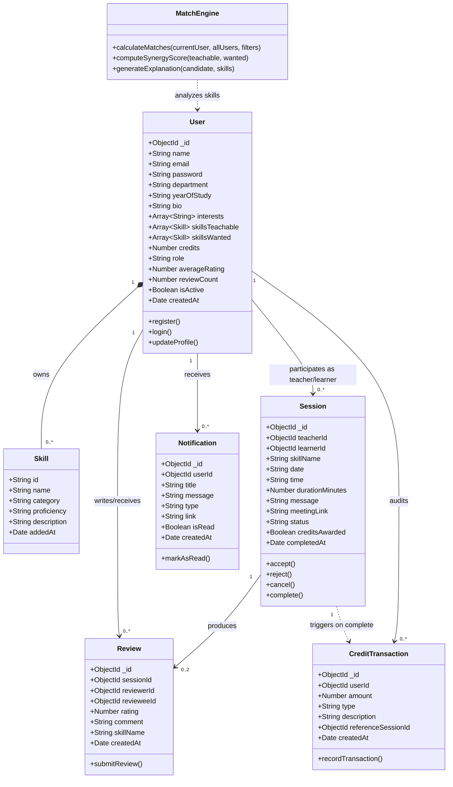

# Class Diagram Specification
## Peer Skill Exchange Platform

---

## 1. Mermaid Class Diagram

---

## 2. Entity Descriptions & Design Patterns

1. **User Entity**:
   - Represents either a `student` or `admin`.
   - Embeds sub-documents for `skillsTeachable` and `skillsWanted` to enable atomic updates and efficient sub-document indexing.
2. **Session State Entity**:
   - Implements a deterministic Finite State Machine: `pending` $\rightarrow$ `accepted` $\rightarrow$ `completed`.
   - Protects credit issuance with the `creditsAwarded` boolean guard.
3. **CreditTransaction Ledger**:
   - Append-only financial record pattern (audit trail). Ensures credits can never be mutated arbitrarily from client requests.
4. **MatchEngine Service**:
   - Pure domain service encapsulating business rules for two-way reciprocal pairing.
