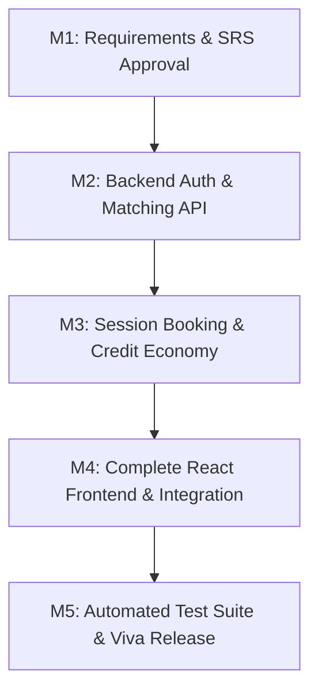

# Software Engineering Project Plan (SEPM)
## Peer Skill Exchange Platform

**Subject:** Software Engineering and Project Management (SEPM)  
**Methodology:** Agile Scrum (4 One-Week Sprints)  
**Version:** 1.0.0  

---

## 1. Project Objectives
1. Provide college students with a non-monetary platform for mutual skill exchange.
2. Implement a transparent, rules-based two-way matching algorithm.
3. Design a gamified skill credit economy preventing free-rider abuse.
4. Deliver modular, clean, and easily explainable full-stack software compliant with academic evaluation criteria.

---

## 2. Work Breakdown Structure (WBS)

```
1.0 Peer Skill Exchange Platform
├── 1.1 Requirements & Planning (Sprint 1)
│   ├── 1.1.1 Stakeholder Interview & User Persona Modeling
│   ├── 1.1.2 IEEE 830 SRS Specification
│   ├── 1.1.3 Risk Identification & Feasibility Analysis
│   └── 1.1.4 Architecture Design & Entity Relationship Modeling
├── 1.2 Core Backend Infrastructure (Sprint 2)
│   ├── 1.2.1 Express Server & Dual-Engine Storage Setup (MongoDB + File Store)
│   ├── 1.2.2 User Authentication (bcrypt + JWT)
│   ├── 1.2.3 Skill Management APIs (Teachable & Wanted)
│   └── 1.2.4 Rules-Based Skill Matching Engine
├── 1.3 Booking System & Economy (Sprint 3)
│   ├── 1.3.1 Session Lifecycle Engine (State Machine)
│   ├── 1.3.2 Skill Credit Transaction Ledger
│   ├── 1.3.3 Peer Rating & Review Integrity System
│   └── 1.3.4 In-App Notification Dispatcher
└── 1.4 Frontend UI & Quality Assurance (Sprint 4)
    ├── 1.4.1 React (Vite) Design System & Component Library
    ├── 1.4.2 Dashboard, Profile, Skills, & Matching Views
    ├── 1.4.3 Admin Governance Console
    ├── 1.4.4 Automated Backend Test Suite Execution
    └── 1.4.5 Production Bundle Compilation & Documentation Finalization
```

---

## 3. Four-Week Sprint Schedule & Gantt Timeline

| Sprint | Week | Key Deliverables & Focus | Milestone Target |
|---|---|---|---|
| **Sprint 1** | Week 1 | Requirements Engineering, SRS documentation, UML Diagrams (Use Case, Class, Architecture). | Milestone 1: Requirements Signed Off |
| **Sprint 2** | Week 2 | Server scaffold, Auth (JWT/Bcrypt), User & Skill Models, Matching Algorithm implementation. | Milestone 2: Core Matching Engine Functional |
| **Sprint 3** | Week 3 | Session booking state machine, Credit ledger, Review validation, Notification system. | Milestone 3: End-to-End Barter Lifecycle Ready |
| **Sprint 4** | Week 4 | React SPA design, Responsive Dashboard, Admin portal, Integration tests, Deployment. | Milestone 4: Final Viva Demo & Code Complete |

---

## 4. Milestone Matrix & Dependencies



### Critical Path Analysis
1. **Critical Path Items**:
   - `FR-01 (Auth)` $\rightarrow$ `FR-02 (Skills)` $\rightarrow$ `FR-03 (Matching Algorithm)` $\rightarrow$ `FR-04 (Booking State Machine)` $\rightarrow$ `FR-05 (Credit Award)` $\rightarrow$ `FR-06 (Reviews)`.
2. **Buffer Allocation**:
   - 2-day contingency reserve before academic demo for test regression and seed validation.

---

## 5. Team Roles & Responsibilities (RACI Matrix)

| Activity | Lead Full-Stack Dev | UI/UX Designer | QA Engineer | Project Manager |
|---|---|---|---|---|
| SRS & Planning | Responsible | Consulted | Consulted | Accountable |
| Database & Models | Responsible | Informed | Consulted | Accountable |
| Matching Algorithm | Responsible | Informed | Consulted | Accountable |
| React UI / Components | Accountable | Responsible | Consulted | Informed |
| Test Suite Execution | Consulted | Informed | Responsible | Accountable |
| Final Viva Presentation | Responsible | Consulted | Consulted | Accountable |
