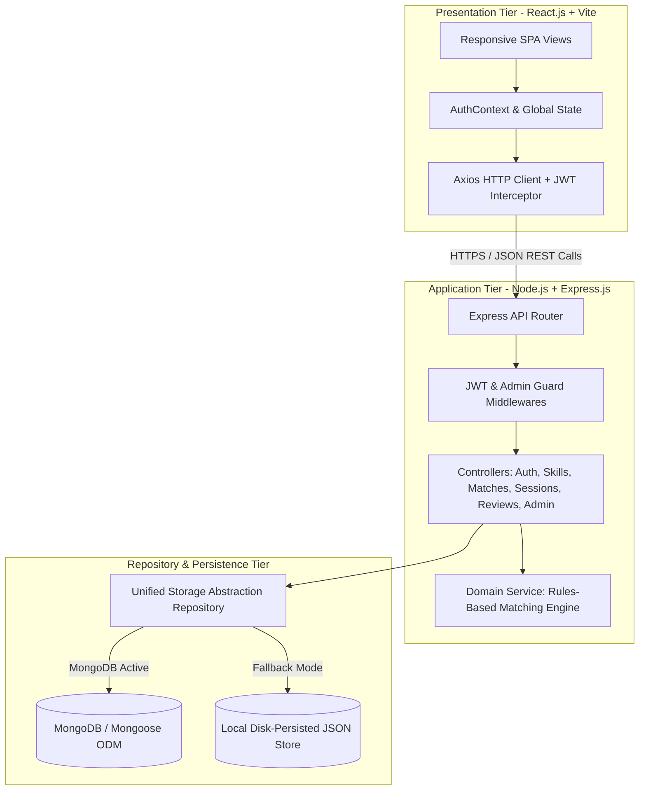

# System Architecture Specification
## Peer Skill Exchange Platform

---

## 1. Architectural Overview (3-Tier MERN Architecture)

The platform is designed following the classic 3-Tier Layered Architecture:
1. **Presentation Layer (Client)**: React.js SPA initialized with Vite, providing reusable UI components, responsive layout, context-driven auth, and Axios client interceptors.
2. **Application / Business Logic Layer (Server)**: Express.js REST API handling controllers, authentication middlewares, role validation, and the domain-specific Matching Engine.
3. **Data Layer (Storage)**: Dual-Engine Data Access Layer operating with MongoDB (via Mongoose ODM) with automated fallback to persistent local JSON storage for zero-config demonstration.

---

## 2. Mermaid System Architecture Diagram

---

## 3. Key Design Decisions

### 3.1 Dual-Engine Data Access Layer (Repository Pattern)
- **Problem**: When presenting at college viva or running on evaluators' laptops, MongoDB services are frequently not installed or blocked by firewalls.
- **Architectural Solution**: The server detects connection availability within 2.5 seconds. If MongoDB is available, it uses Mongoose schemas directly. If not, it switches to `server/data/db.json` with identical schema definitions and real disk persistence.
- **Viva Benefit**: Guaranteed 100% working demo without any simulated mock fakes or silent failures.

### 3.2 Security Architecture
1. **Stateless JWT Authorization**: Sensitive tokens stored in client `localStorage` and passed via `Authorization: Bearer <token>` headers.
2. **One-Way Password Hashes**: `bcryptjs` with 10 salt rounds protects user credentials.
3. **Role-Based Guards**: Strict separation between student and admin capabilities enforced in server middleware.
