# Use Case Specification & Diagram
## Peer Skill Exchange Platform

---

## 1. Mermaid Use Case Diagram

```mermaid
flowchart TD
    %% Actors
    Student([🎓 College Student])
    Admin([🛡️ Platform Administrator])

    subgraph Platform Boundary [Peer Skill Exchange Platform]
        UC1([Register & Authenticate])
        UC2([Manage Teachable & Wanted Skills])
        UC3([View Two-Way Skill Matches])
        UC4([Browse & Discover Peers])
        UC5([Request Learning Session])
        UC6([Accept / Decline / Cancel Session])
        UC7([Mark Session Completed])
        UC8([Submit Peer Rating & Review])
        UC9([View Credit Ledger & Progress])
        UC10([Receive In-App Notifications])
        
        %% Admin specific
        UC11([Inspect Platform Metrics & Stats])
        UC12([Audit Session History])
        UC13([Moderate Student Accounts])
    end

    %% Student Connections
    Student --> UC1
    Student --> UC2
    Student --> UC3
    Student --> UC4
    Student --> UC5
    Student --> UC6
    Student --> UC7
    Student --> UC8
    Student --> UC9
    Student --> UC10

    %% Admin Connections
    Admin --> UC1
    Admin --> UC11
    Admin --> UC12
    Admin --> UC13
```

---

## 2. Core Use Case Descriptions

### UC-03: View Two-Way Skill Matches
- **Primary Actor**: College Student
- **Preconditions**: Student is logged in and has configured at least 1 teachable skill and 1 wanted skill.
- **Main Success Scenario**:
  1. Student navigates to the *Skill Matches* view.
  2. The system executes the matching algorithm comparing the student's skills with all active peers.
  3. The system highlights reciprocal pairs (Student A teaches what B wants, B teaches what A wants).
  4. The system presents each candidate with a synergy match score, proficiency tags, and an explanation.
  5. Student selects "Book Session" to initiate scheduling.

### UC-07: Complete Session & Award Credits
- **Primary Actor**: Session Participant (Mentor or Learner)
- **Preconditions**: Session status is `accepted`.
- **Main Success Scenario**:
  1. Student marks session as conducted.
  2. The system checks `creditsAwarded === false` to prevent duplicate payouts.
  3. The system credits $+5$ tokens to the mentor's balance and records a ledger transaction.
  4. The system updates the session state to `completed`.
  5. Notifications are automatically dispatched prompting a reciprocal review.

### UC-13: Moderate Student Accounts
- **Primary Actor**: Administrator
- **Preconditions**: Authenticated user possesses `role === 'admin'`.
- **Main Success Scenario**:
  1. Administrator visits `/admin`.
  2. Selects a student flagged for policy violations.
  3. Clicks "Suspend Account" button.
  4. System toggles `isActive: false` and revokes future login access until reinstated.
